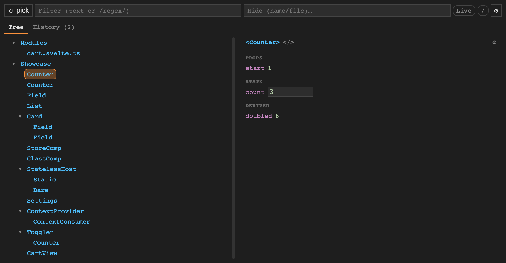

<p align="center">
  
</p>

# runespect

[](https://github.com/lelle/runespect/actions/workflows/ci.yml)
[](./LICENSE)

> **Devtools for Svelte 5: see and edit the live runes state of every component.**

**[▶ Try it live](https://lelle.github.io/runespect/demo/)** — a small shop and the panel, no
install



## Quick start

```sh
npm install --save-dev @runespect/vite-plugin
```

```ts
// vite.config.ts
import { defineConfig } from 'vite';
import { svelte, vitePreprocess } from '@sveltejs/vite-plugin-svelte';
import { runespect, runespectPreprocess } from '@runespect/vite-plugin';

export default defineConfig({
  plugins: [svelte({ preprocess: [vitePreprocess(), runespectPreprocess()] }), runespect()],
});
```

Start the dev server and open `/__runespect/` on it, next to your app. On SvelteKit, see
[Use with SvelteKit](docs/how-to/use-with-sveltekit.md).

For built apps (not running `vite dev`), `includeInRelease` builds runespect into the app. Never deploy
that build to production. See [Choose where to run it](docs/how-to/choose-where-to-run-it.md).

## What you get

- The component tree, with each component's props, state, derived values, stores and context, live
- Editing of `$state`, `$bindable` props and nested fields; the app follows as you type
- `.svelte.ts` module state, and `SvelteSet`, `MediaQuery` and the rest of `svelte/reactivity`
- A history of what changed, flush by flush

In a window next to your app, an overlay inside it, or a Chrome DevTools tab.
[The panel](docs/reference/the-panel.md) has everything it does.

## Why

Svelte 5 has no maintained devtools: `svelte-devtools` stopped at Svelte 4. runespect reads none of
Svelte's internals. A Vite plugin adds reporting code written in Svelte's public API, so it breaks
only if that API does ([Architecture](docs/explanation/architecture.md)).

## Documentation

Full docs live in **[`docs/`](docs/README.md)**, organised by intent
([Diátaxis](https://diataxis.fr/)), and on the site at
[lelle.github.io/runespect/docs](https://lelle.github.io/runespect/docs/):

- **Learn** — [Getting started](docs/tutorials/getting-started.md)
- **Do** — [where to run it](docs/how-to/choose-where-to-run-it.md) · [SvelteKit](docs/how-to/use-with-sveltekit.md) ·
  [panel window](docs/how-to/open-the-panel-window.md) ·
  [overlay](docs/how-to/add-the-overlay.md) · [extension](docs/how-to/use-the-extension.md) ·
  [troubleshoot](docs/how-to/troubleshoot.md)
- **Look up** — [The panel](docs/reference/the-panel.md) · [Options](docs/reference/options.md) ·
  [Console API](docs/reference/console-api.md) · [Packages](docs/reference/packages.md)
- **Understand** — [Architecture](docs/explanation/architecture.md) ·
  [What the panel can show](docs/explanation/tiers.md) · [What it costs](docs/explanation/what-it-costs.md)

To work on runespect itself, see [`CONTRIBUTING.md`](CONTRIBUTING.md).

## License

[MIT](LICENSE)
