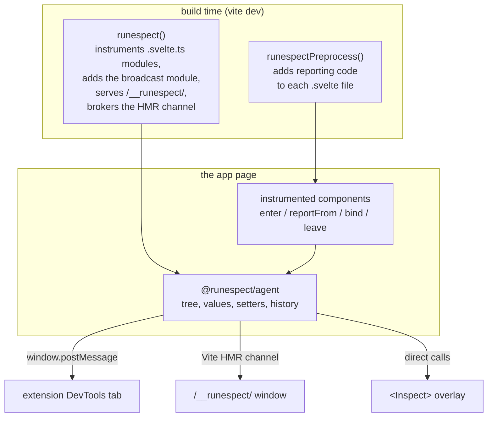
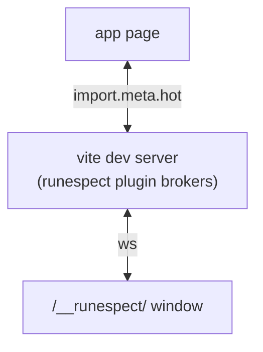

# Architecture

How runespect gets from a Svelte component to a row in the panel.

## Principle: report through the public API

Svelte 5's runtime keeps its state in private, single-letter fields that change between releases
and exist only in dev builds. runespect does not read them. Instead, the Vite plugin adds code to
each component at build time, written in Svelte's public API, and that code reports to an agent in
the page. It breaks only if the public contract breaks: `$effect`, `$state.snapshot`,
`getContext`/`setContext`, `onDestroy` and plain assignment.

| Devtools need       | How runespect gets it                                                     |
| ------------------- | ------------------------------------------------------------------------- |
| Component tree      | each component reads its parent's node from context and sets its own      |
| Live values         | a function per value that reads it, which the agent reads in an `$effect` |
| Names and locations | the file name and path, known at build time                               |
| Which value is what | `$state`, `$derived`, `$props()`, stores, context: read from the source   |
| Editing             | a setter per writable value, `(v) => { count = v; }`: a public assignment |

The only code that reads Svelte's internals is the experimental capture in `packages/proxy` and
`packages/prod-reader`, which is not part of the released packages (see
[Tiers](tiers.md)).

## Overview



## 1. Instrumentation (`packages/vite-plugin`)

The package exports two functions, and an app needs both.

### `runespectPreprocess()`: components

A Svelte preprocessor (`src/preprocess.ts`). When it runs, and on which files, is in
[Options](../reference/options.md#runespectpreprocessoptions).

It parses the component with `svelte/compiler` and decides the component's mode the way Svelte
does, because the code it adds must not change that mode. The added code only hands the agent a
function that reads each value, which is legal in every mode, and a component that is neither runes
nor legacy only joins the tree. What a component or a module reports, and which of its values the
panel may write, is decided in one place (`src/symbols.ts`), from the parsed source.
Stores such a component reads are reported through their own subscription. Which values each mode
reports is listed in [Options](../reference/options.md#what-is-reported). Every matched component joins the
tree, including one without a `<script>`: the preprocessor adds one. For a runes component the
added code looks like this (the imports go at the start of the instance script, the rest at the
end):

```js
import * as __runespect from '@runespect/agent/runtime';

__runespect.component({
  name: 'Counter',
  loc: '/app/src/Counter.svelte',
  symbols: {
    count: {
      kind: 'state',
      read: () => count,
      write: (v) => {
        count = v;
      },
    },
    doubled: { kind: 'derived', read: () => doubled },
  },
});
```

The plugin only describes what the file has; the agent's runtime does the rest (below).

- The name is the file name, and for a SvelteKit route file the route, as in `+page (blog/[slug])`.
  `loc` is the file path, used by open-in-editor.
- `kind` tells the panel how to group each value.
- `write` exists only for values a plain assignment can change: `let` state, `$bindable()` props
  and `$state` class fields. `$derived`, other props, stores and context are read-only.
- The closures stay in the app's file because Svelte must compile them there. A store in a
  component without runes or legacy syntax is passed as `store`, and read through its own
  subscription.
- The edit is made with `magic-string` and returns a sourcemap, so errors and breakpoints still
  point at the original lines.

### `runespect()`: the dev server

A Vite plugin (`src/index.ts`) that `vite build` does not run unless `includeInRelease` is on. It:

- **Adds the broadcast module** `virtual:runespect-broadcast` to the page. It calls the runtime's
  `start({ hot: import.meta.hot })`, which reports to the window (the extension) and over the hot
  channel (the panel window).
  It goes in through a script tag from `transformIndexHtml`, or, under SvelteKit (which never runs
  that hook), appended to SvelteKit's generated client entry.
- **Resolves the agent** from the plugin itself (its runtime, its internals and its public entry
  alike), and excludes `@runespect/agent` and
  `@runespect/ui` from dependency pre-bundling, so the components, the broadcast module and the
  overlay share one agent.
- **Instruments `.svelte.ts` and `.svelte.js` modules** (`src/module-state.ts`): top-level `$state`,
  `$derived` and rune-class instances are reported under a **Modules** root in the tree. A private
  `let` state is editable; an exported one is not, because Svelte refuses a module that reassigns
  state it exports.
- **Brokers the HMR channel** and **serves the panel window** at `/__runespect/` (below).
- Sets the `RUNESPECT_DEV_SERVER` environment variable, which is how `runespectPreprocess()` knows
  the dev server is running, and removes it when the last dev server in the process closes, so a
  build run later in the same process is not instrumented. Vitest also starts Vite in serve mode,
  so under Vitest it is not set.

## 2. The agent (`packages/agent`)

The injected code calls the runtime (`src/runtime.ts`, `@runespect/agent/runtime`) and nothing
else: `component()` while a component starts, `module()` when a `.svelte.ts` module runs, and
`start()` once per page. The runtime finds a component's parent through Svelte's context, leaves
the tree with `onDestroy` (not an `$effect`, so no component is forced into runes mode), and lets
an HMR-replaced module go. Whatever fails in it warns once and leaves the app running. Behind it is
one agent per page, which touches no Svelte internals. `src/internal.svelte.ts` puts it together
from parts that each own their state and import only the parts before them: `tree` (nodes, readers,
edits), `history`, `wire` (serialization and the flush watcher), `observe` (the event log),
`page-actions`, `surface` (`window.__runespect`) and `transport`.

- **Tree.** `enter(name, parent, meta)` adds a node and returns its id; `leave(id)` removes it and
  its setters. A module that runs again after HMR replaces its node. On the server every call is a
  no-op, so SSR does not leak nodes.
- **Quiet until a panel opens.** Reading a value evaluates it, so a `$derived` the app never reads
  would run on every change. Until a panel asks, the agent reads nothing, watches nothing and sends
  only its `hello`. The first `request` (the panel window, the extension), the overlay or a call to
  `window.__runespect` starts it, and it keeps going for the page's lifetime.
- **Values.** `reportFrom(id, symbol, read)` keeps the function and, once a panel has opened, reads
  it in an `$effect` of the agent's own, so a `$derived` that throws is shown as its error instead
  of breaking the component. Values are copied with
  `$state.snapshot`, except values that hold functions or class instances, which are kept as they
  are and stubbed when sent. A `URLSearchParams` is copied, and a reactive class such as
  `MediaQuery` is read through `current`, so a change to either reports again.
- **Editing.** `bind(id, symbol, setter)` stores the setter. An edit of a nested field copies only
  the objects on its path from the app's live value and assigns the new root.
- **Changes.** Once a panel has opened, one `$effect.root` watches the tree. Each flush becomes a
  list of ops (add, update, remove) and a commit in the history, which therefore starts when the
  first panel opens: at most 200 commits and about 4 MB, after which the oldest
  are dropped and the history is marked truncated.
- **Page actions.** Highlight a component's element, pick an element, log a node to the console,
  store a value as `window.$r`: the app's own object, so a call on it changes the app.
- **`window.__runespect`.** The tree, values, history and `set()` for the console, a test or a
  coding agent, plus the event log of every hop (see [Event log](../reference/event-log.md)).
- A second copy of the agent in the page logs a warning, because components would be split between
  the two.

`@runespect/agent` itself exports only the types of `window.__runespect`. The injected code calls
`@runespect/agent/runtime`; the overlay and the tests use `@runespect/agent/internal`. Both are
released together with the plugin.

## 3. The protocol

The messages and value encoding shared by the agent and every panel
(`packages/agent/src/protocol/internal.ts`). The page announces itself with `hello` and sends its
tree once, then a delta per flush; the panel sends commands addressed to the page it follows. Values
go one level deep, and the panel asks for more.
Every message, field, sequence and encoding is in [Protocol](../reference/protocol.md).

- `PROTOCOL_VERSION` is compared in the handshake; a mismatch shows as a warning in the panel.
- `@runespect/agent/protocol` exports the types; `@runespect/agent/protocol/internal` the wire
  format, which can change with the protocol version.

## 4. Transports

`connect(transport)` takes anything with `send` and `onMessage`. The agent can be connected to
several at once; a flush is still diffed and recorded once.

- **Window** (`createWindowTransport`): `window.postMessage`, for the extension. It hears only
  messages its own window sent, and drops its own echoes by a per-instance tag.
- **Vite HMR** (`createHotTransport`): the `runespect:msg` event on Vite's HMR socket, for the panel
  window. Same echo tag.
- **Extension** (`packages/extension`): the content script relays between the page's `postMessage`
  and `chrome.runtime` (`src/relay.ts`). The service worker routes by tab to that tab's DevTools
  panel (`src/routing.ts`), whose port reconnects when Chrome stops the idle worker
  (`src/panel-port.ts`).
- **Direct**: the `<Inspect>` overlay calls the agent in the same page, without messages.

### Who can talk to the agent

A production build carries no runespect, unless `includeInRelease` puts it there. The window transport hears only messages its own
window sent, so an iframe on the page (an ad, an embed) cannot send `edit`. The HMR broker forwards
only messages of the kinds above; Vite's own token keeps other sites off the socket, while anyone who
can open the app (on the LAN with `--host`) can also open the panel, and the dev server already
serves them the source. `edit` calls the setter of one declared value with plain data: no code runs,
and a sender never sees the tree. The page URL in `hello` has secret-looking query values replaced.

## 5. The panel UI (`packages/ui`)

`<Panel>` (in `@runespect/ui/internal`) renders the tree, the selected component's values, the
history and the status chip. It depends on nothing but a transport, which is why the same component
runs in the extension's DevTools tab and in the panel window.

`<Inspect>`, the one public export of `@runespect/ui`, is the in-page overlay. The app mounts it
itself. It renders inside its own shadow root, so the page's CSS cannot reach it, and reads the
agent directly.

The status chip comes from `src/status.ts`: **Tier 0** when the page's `hello` says so, **Tier 1**
when a tree has arrived with no tier two seconds after the panel opened, and a warning for a
protocol mismatch or when no page answers. The tiers are described in
[Tiers](tiers.md).

## The panel window (`/__runespect/`)

`<Panel>` depends on nothing but a `Transport` — two methods, `send` and `onMessage`. That seam is
what lets the same component run in three places: the browser extension (chrome runtime port), the
playground's panel page (`apps/playground/panel.html`, window.postMessage) and the standalone window the Vite plugin serves.



Details worth knowing:

- **Why Vite's HMR channel** and not a WebSocket server of our own: no new dependency, no second
  port, and it is already `wss` when the app runs over https — a plain `ws://` from an https page is
  blocked as mixed content.
- **Why the panel is prebuilt** (`panel/vite.config.ts` → `panel-dist/`, served by middleware): the
  host app's Svelte pipeline must not compile the devtools — runespect's own preprocessor would
  instrument them.
- **Why `createHotContext` and not `import.meta.hot`**: a build replaces `import.meta.hot` with
  `undefined`, which would silently tree-shake the whole panel away. `createHotContext` from `/@vite/client`
  is the same primitive Vite injects when it rewrites `import.meta.hot`, and it is left external so
  the dev server resolves it at runtime.
- **Echo filtering**: the broker rebroadcasts to every client, the sender included, so each end tags
  its sends and drops its own — the same guard `createWindowTransport` uses.
- **Under a Vite `base`** the window moves with the app: `base: '/app/'` serves it at
  `/app/__runespect/` (`src/panel-route.ts`).
- **One channel, many clients**: every page and every panel window on that dev server hears
  everything — a second tab, another route, the playground's panel page, islands from separate bundles. The
  panel therefore follows exactly one _source_, and says which one.
  - Each page announces `{ id, url, title }` in its `hello` and stamps `from` on everything it
    sends. `id` is new per page load, because a reload is a new agent with a new tree.
  - The panel keeps every source it has heard from, and follows: the explicit choice → the url it
    followed last (a reload changes the id, the url survives) → the first heard. `ui/follow.ts`
    holds the whole rule as one pure step per message heard, pick or command: which page is
    followed, what is shown, what is sent, and when the panel drops what it holds.
  - The status chip names the followed page, and becomes a picker when there is more than one.
    Sources show a _last seen_ age rather than a live/dead verdict: on a shared bus a quiet page and
    a closed one are indistinguishable, and guessing would switch you away mid-debugging.
  - Filtering is panel-side, not transport-side, on purpose: a transport that bound to one peer
    would hide the other pages before the panel could offer them.
  - Commands are **addressed**: the panel stamps `to` with the page it follows, and a page ignores
    anything meant for another. Without it, one shared channel would deliver every command everywhere —
    an edit from the panel window would change the same component in every open tab.
  - `/__runespect/?source=/some/path` says which page a panel window was opened _for_, and beats the
    remembered choice. With several pages live, first-heard-wins is a coin flip; this is how the e2e
    suite (and a developer with two tabs) says what it means. Until that page answers, the panel
    follows no other and shows nothing it hears: it would ask that page by name and wake it.
  - A page starts reading when a panel asks it **by name**. The panel's first `request` goes to
    every page and only learns who is there, from their `hello`s; then it asks the page it follows.

## Limits

- **Only declared values are visible.** State created inside a function, or held by a library
  component, is not shown.
- **Library components are not instrumented**: files under `node_modules` are skipped.
- **Props are read-only** unless declared `$bindable()`.
- **History starts when the first panel opens.** What happened before is not recorded.
- **Cost:** none to speak of until a panel opens; then one `$effect` per reported value, in dev
  only. [What it costs](what-it-costs.md) has
  measurements.
