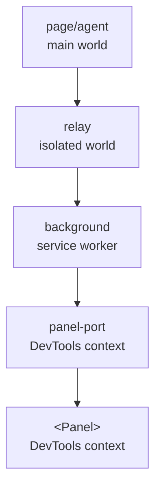

# Observability — `window.__runespect`

runespect spans five contexts, and four of them are invisible to the page: the content-script relay
runs in an isolated world, the background is an MV3 service worker, and the panel lives in the
DevTools context. When something goes quiet, the failure is usually in a hop nobody can see.

Every hop therefore keeps a small ring buffer of what crossed it, and mirrors it into the
**inspected page** — the one context a developer, an e2e test and a coding agent can all read.

```js
window.__runespect.events; // the merged timeline, oldest first
window.__runespect.since(seq); // the agent's events after `seq` — for polling
window.__runespect.dump(); // the whole timeline as JSON, for a bug report
```

The surface is published by the agent as soon as it connects, and is **always on**: the point of a
log is the failure that already happened, not the one you can reproduce on demand.

## The chain



| hop          | records                                           |
| ------------ | ------------------------------------------------- |
| `agent`      | messages sent, refused sends, connect, tier       |
| `relay`      | what it forwards in each direction                |
| `background` | sends to a tab it could not deliver               |
| `panel-port` | connect, disconnect, reconnect, messages received |
| `panel`      | messages the panel received, panes that failed    |

The relay cannot reach `window.__runespect` from the isolated world, and the panel cannot reach the
page at all, so both post their buffers inward: the relay via `window.postMessage` with
`kind: 'events'`, the panel via `chrome.devtools.inspectedWindow.eval` calling `absorb()`. That kind
is one of the protocol's [control messages](protocol.md#control-messages), outside its direction lists: it is diagnostics, not part
of the tree conversation.

The relay sends only what the page has not had: the page lives exactly as long as the relay. The
background and the panel send their whole buffers each time, because the port or the page behind
them can be replaced while they live; `absorb()` drops what it already has. One module decides this
for every hop (`packages/extension/src/mirror.ts`).

## An event

```js
{ t: 1787224653428, seq: 41, hop: 'relay', ev: 'tx', kind: 'tree', nodes: 44 }
```

| field   | meaning                                                                        |
| ------- | ------------------------------------------------------------------------------ |
| `t`     | wall-clock ms — how hops merge into one timeline                               |
| `seq`   | per-hop counter; a gap means the window dropped it, not that it never happened |
| `hop`   | where it happened                                                              |
| `ev`    | `tx` `rx` `connect` `reconnect` `disconnect` `drop` `tier` `error`             |
| `kind`  | the protocol message kind, for `tx`/`rx`                                       |
| `error` | why, on a `drop`; the message, on an `error`                                   |
| `pane`  | which pane failed to render, on an `error`                                     |

**Envelopes only.** Kinds, counts, sizes and lifecycle — never the app's values. The log is pasted
into bug reports with `dump()`, so it must not carry application state. The same global also reads
the app itself (`tree()`, `values()`, `set()`, see [Console API](console-api.md)), but only on request, and only in dev.

## Reading it as an agent

```js
// what happened, in order
await page.evaluate(() => window.__runespect.events.slice(-20));

// did the panel's port survive the service worker?
await page.evaluate(() => window.__runespect.events.filter((e) => e.hop === 'panel-port'));

// everything, for a report
await page.evaluate(() => window.__runespect.dump());
```

Start from the symptom, not from here: [Troubleshoot](../how-to/troubleshoot.md) maps what you
see in the panel to what to read in the log.

Failures this makes visible: a relay that silently
dropped a message kind, a value the wire refused (`ev: 'drop'`, `error: 'DataCloneError'`), a panel
port taken down with the idle service worker (`disconnect` with no `reconnect`), and a page that
never announced its tier (no `tier` event, so the panel reports Tier 1).
