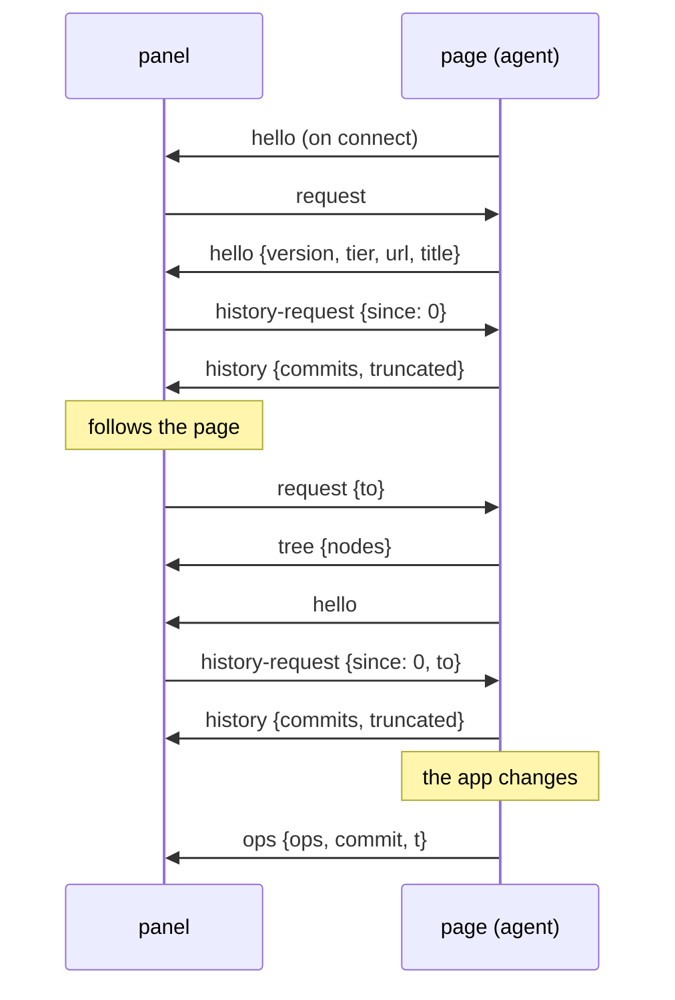
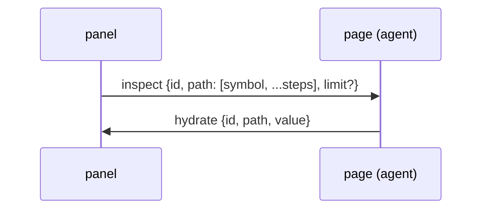
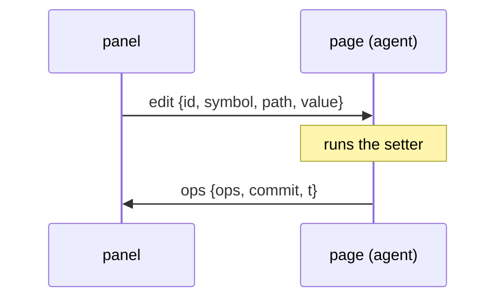
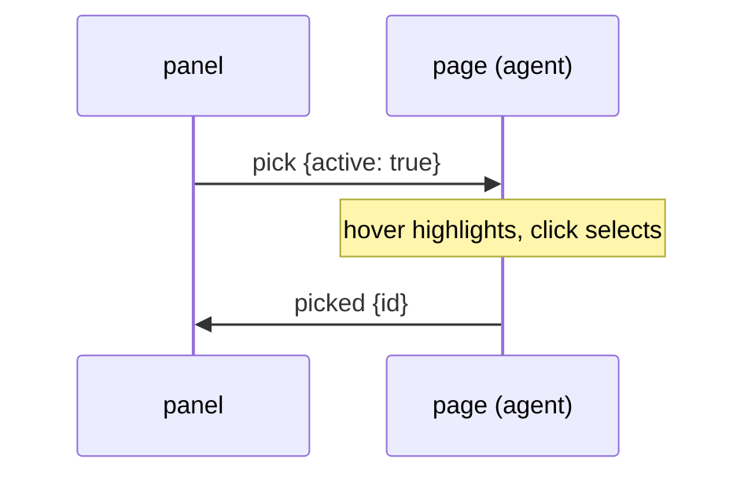

# Protocol

The messages a page and a panel exchange, what each one carries, and how the transports move them.
This page is for contributors: the wire format is internal (`@runespect/agent/protocol/internal`) and
changes with `PROTOCOL_VERSION`, which is `1`. The code that defines it is
`packages/agent/src/protocol/internal.ts`; a test (`apps/playground/test/protocol-doc.test.ts`) fails when
a kind or a value marker is added there without a section here, or removed there and left here.

## The envelope

Every message is a plain JSON object. The extension relay and the HMR channel carry JSON, not
structured clone, so nothing else crosses: values JSON cannot hold are encoded (see
[Values](#values)).

| Field      | On                  | Meaning                                                                          |
| ---------- | ------------------- | -------------------------------------------------------------------------------- |
| `source`   | every message       | always `'runespect'`; how a listener on a shared channel finds ours              |
| `kind`     | every message       | which message it is                                                              |
| `from`     | page to panel       | the page's id, new on every page load; stamped by the agent on all it sends      |
| `to`       | panel to page       | the page a command is meant for; a page drops a command addressed to another     |
| `__rsFrom` | window and HMR only | the sending transport's own tag, so it can drop the copy the channel echoes back |

Each kind goes one way, listed in `TO_PANEL_KINDS` and `TO_PAGE_KINDS`, and a side handles only the
other direction's kinds. The window transport and the HMR broker hand a sender its own messages back,
so a kind that one side both sent and handled would loop. The compiler rejects a kind that is in
neither list.

A message without `from` is from a page that has no agent: the extension's Names only walk or the capture
capture (see [Other senders](#other-senders)). A command without `to` is for whoever hears it, which
is what the extension relies on: its service worker already routes by tab.

## Sequences

### Connecting

A panel starts by asking every page who is there. Only a page asked by name (or one this transport
already follows) starts reading its values and sends its tree; until then the agent stays quiet.

The hello on connect is for a panel that was open before the page loaded: its one `request` went
out before the page existed. A reload is a new page with a new id; the panel follows it again by its
url.

### Opening a value

The tree carries values one level deep. To show more, the panel asks for the value at a path, and
keeps the reply beside the tree the page sent (`ui/held.ts`).

### Editing a value

There is no reply of its own. The change comes back as the `ops` of the flush it caused, or not at
all when the page refused the edit.

### Picking an element

Escape answers `picked` with `id: null`. `pick` with `active: false` ends a pick without an answer.

## Messages

### `hello`

Page to panel. Who the page is and which version it speaks. Sent when the agent connects and as
the answer to every `request`.

| Field          | Type      | Meaning                                                                     |
| -------------- | --------- | --------------------------------------------------------------------------- |
| `version`      | `number`  | the page's `PROTOCOL_VERSION`; the panel warns when it differs from its own |
| `tier`         | `0 \| 2`  | `0` from the agent, `2` from the capture; absent means Names only           |
| `problem`      | `string?` | why a capture recorded nothing                                              |
| `url`          | `string?` | path and query, with secret-looking query values replaced by `…`            |
| `title`        | `string?` | the page's `document.title`                                                 |
| `openInEditor` | `false?`  | present when the app turned Open in editor off                              |

### `request`

Panel to page. No fields of its own. Without `to` it asks who is there, and every page answers with
a `hello`. With `to`, or from a transport the page already serves (a reconnect), the page also starts
following its flushes and sends a `tree`.

### `tree`

Page to panel. `nodes: SerializedNode[]`, the whole tree. Sent once per transport, as its first
answer; after that the page sends `ops`. A panel keeps a tree it already has when an empty one
arrives.

| Node field | Type                         | Meaning                                                                             |
| ---------- | ---------------------------- | ----------------------------------------------------------------------------------- |
| `id`       | `number`                     | the node's id in this page                                                          |
| `name`     | `string`                     | the component's name, or the route for a SvelteKit file                             |
| `parent`   | `number \| null`             | `null` for a root                                                                   |
| `children` | `number[]`                   | the children's ids, in order                                                        |
| `snippets` | `string[]`                   | names of the snippets the component declares                                        |
| `values`   | `Record<string, unknown>`    | each reported value, encoded one level deep                                         |
| `writable` | `string[]`                   | the values an `edit` may change                                                     |
| `kinds`    | `Record<string, SymbolKind>` | per value: `state`, `derived`, `prop`, `store`, `class`, `context` or `context-set` |
| `loc`      | `string?`                    | the file, for Open in editor                                                        |

### `ops`

Page to panel. What one flush changed.

| Field    | Type       | Meaning                                                             |
| -------- | ---------- | ------------------------------------------------------------------- |
| `ops`    | `TreeOp[]` | `{op: 'add', node}`, `{op: 'update', node}` or `{op: 'remove', id}` |
| `commit` | `number?`  | the commit's sequence number, the same on every transport           |
| `t`      | `number?`  | when the flush happened, in ms                                      |

An `add` or `update` carries the whole node: a node lists its own children, so a structural change
is an update of the nodes it touches. A node is updated when its JSON differs from what was sent
(`opFor`). The panel builds its history from these with `commitFromOps`, the same function the agent
uses, so previous values never cross the wire.

### `history-request`

Panel to page. `since: number`: send the commits with a higher sequence number; `0` asks for all the
page still holds.

### `history`

Page to panel. `commits: Commit[]` and `truncated: boolean`, which is true when the page dropped older
commits. A commit is `{seq, t, changes}`; a change is `{op, id, name, symbol?, from?, to?}`. The page
keeps at most 200 commits (`HISTORY_COMMITS`), from the moment the first panel opened.

### `inspect`

Panel to page. `id`, `path` (`[symbol, ...steps]`) and an optional `limit`: how many entries of a
wide value to send. A step is a key, an array index, or for a Map or Set the entry's index; the rule
is in `agent/src/protocol/valuePath.ts`.

### `hydrate`

Page to panel. The answer to `inspect`: the same `id` and `path`, and `value`, read from the app's
live value and encoded one level deep, with a class instance at the top expanded into its fields.
`value` is absent when the node or the path is gone.

### `edit`

Panel to page. `id`, `symbol`, `path` (the steps inside the value; empty replaces it) and `value`.
The page writes into the app's live value, never the panel's copy: it copies the objects along the
path and assigns the result as the whole value. It
refuses, without an answer, when the value has no setter, when `value` holds any marker (the panel's
copy has markers where it did not load the data), or when the path cannot be written.

### `highlight`

Panel to page. `id: number | null`: draw a box over that node's element, or clear it.

### `pick`

Panel to page. `active: boolean`: start or end element picking.

### `picked`

Page to panel. `id: number | null`: the node the user clicked, or `null` when they pressed Escape.

### `log`

Panel to page. `id`: log that node to the page's console.

### `storeGlobal`

Panel to page. `id` and `symbol`: store the app's own value as `window.$r`.

## Control messages

They travel the same channels but are not about the tree, so no side handles them together with its
direction's kinds, and neither kind may be a `Message` kind. They carry `source` and `kind` like the
others, and no `from` or `to`.

### `events`

`events: RunespectEvent[]`: a hop's event log, handed inward to the page where the agent merges it
into `window.__runespect.events`. The relay posts it to the page window; the service worker sends it
to the panel over the port; the panel, which cannot post to the page, evaluates
`window.__runespect.absorb(events)` in it (`absorbExpression`). What an event holds is in
[Event log](event-log.md).

### `register`

`tabId: number`: a DevTools panel naming its tab to the extension's service worker, on its port.
From then on the worker sends that panel's commands to that tab and the tab's messages to that panel.

## Values

A value goes out one level deep: a container inside a container becomes a `dehydrated` marker, which
the panel opens with `inspect`. A container wider than 100 entries is cut, and a string longer than
10,000 characters. A symbol is sent as a string, `Symbol(name)`. A class instance with `$state` fields
(get/set pairs) or a getter-only `current` is reactive state and is sent with its fields; any other
class instance is a stub. Everything else JSON cannot hold is an object with a `__runespect` tag:

| Tag               | Fields                               | For                                                                                 |
| ----------------- | ------------------------------------ | ----------------------------------------------------------------------------------- |
| `undefined`       |                                      | `undefined`                                                                         |
| `number`          | `value`                              | `'NaN'`, `'Infinity'` or `'-Infinity'`                                              |
| `bigint`          | `value`                              | the digits                                                                          |
| `date`            | `iso`                                | the ISO string, `null` for an invalid date                                          |
| `regexp`          | `source`, `flags`                    | a regular expression                                                                |
| `error-object`    | `name`, `message`                    | an `Error` held as a value                                                          |
| `map`             | `entries`                            | `[key, value]` pairs; keys are encoded like values                                  |
| `set`             | `values`                             | the members                                                                         |
| `urlsearchparams` | `entries`                            | `[name, value]` pairs, in order, a name possibly repeated                           |
| `string`          | `head`, `length`                     | the first 10,000 characters of a longer string                                      |
| `instance`        | `name`, `fields`                     | a class instance: its own fields and its get/set pairs                              |
| `function`        | `name`                               | a function, a method or a snippet                                                   |
| `error`           | `message`                            | a value whose read threw: shown as the error                                        |
| `dehydrated`      | `type`, `preview`, `size`, `opaque?` | a container below the first level; `opaque` for binary data, which cannot be opened |
| `partial`         | `value`, `size`                      | the first entries of a wide container, and how many it has                          |

`dehydrated.type` is `object`, `array`, `map`, `set`, `urlsearchparams`, `typedarray` or
`arraybuffer`. The encoding is `dehydrate()` in `agent/src/protocol/dehydrate.ts`, which must stay
self-contained: the Tier 2 capture embeds its source.

## Transports

`Transport` is two methods, `send(message)` and `onMessage(callback)`. The agent can hold several at
once; a flush is still diffed once and every transport sends the same commit.

- **Window** (`createWindowTransport`, in the agent): `window.postMessage` to the page's own window.
  It hears only messages whose `event.source` is that window, so an iframe cannot send `edit`.
- **HMR** (`createHotTransport`): the `runespect:msg` event on Vite's HMR socket, between the page and
  the panel window at `/__runespect/`. The plugin's broker forwards only messages whose `kind` is in
  one of the two direction lists, and sends each to every client, its sender included.
- **Page channel** (`pageChannel`): the same event over a `BroadcastChannel`, between the page and the
  panel window of an `includeInRelease` build. The browser delivers each message to every other
  document of the origin; there is no broker.
- **Extension**, in four hops (the chain is drawn in [Event log](event-log.md#the-chain)):
  - the content-script relay (`extension/src/relay.ts`) passes page-to-panel kinds from the window to
    `chrome.runtime`, and panel-to-page kinds back;
  - the service worker (`routing.ts`) keeps one panel port per tab, learned from `register`;
  - the panel's port (`panel-port.ts`), named `runespect-panel` (`PANEL_PORT`), reconnects when Chrome
    stops the idle worker, sends `register` again every 20 seconds, and sends `request` after a
    reconnect, because the tree it holds may be stale;
  - the panel itself (`panel-hop.ts`), which hands control messages to its event log.
- **Direct**: no messages at all. The `<Inspect>` overlay runs in the page and reads the agent
  itself.

## Other senders

Two senders speak the page's side without the agent. Neither stamps `from`, and neither handles
`edit`.

- **Names only** (`extension/src/content-tier1.ts`): on a dev Svelte page without the plugin, the
  extension walks the DOM's `__svelte_meta` and posts a `tree` with names and locations but no values.
  It posts when the tree changed and on any `request`, sends no `hello`, and stays quiet once the
  page's window has `__runespect_tier0` (`TIER0_FLAG`), which the agent and the capture set. A panel
  that has a tree and no tier two seconds after it opened shows Names only.
- **Tier 2** (`packages/proxy`, experimental): the capture's bridge posts a `hello` with `tier: 2`,
  the shared `PROTOCOL_VERSION` and a `problem` when the capture found nothing, and a read-only `tree`
  encoded with the same `dehydrate()`. See [What the panel can show](../explanation/tiers.md).
